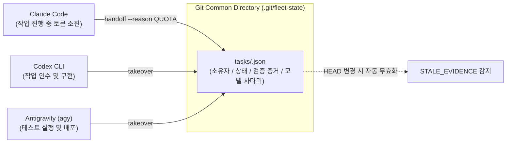
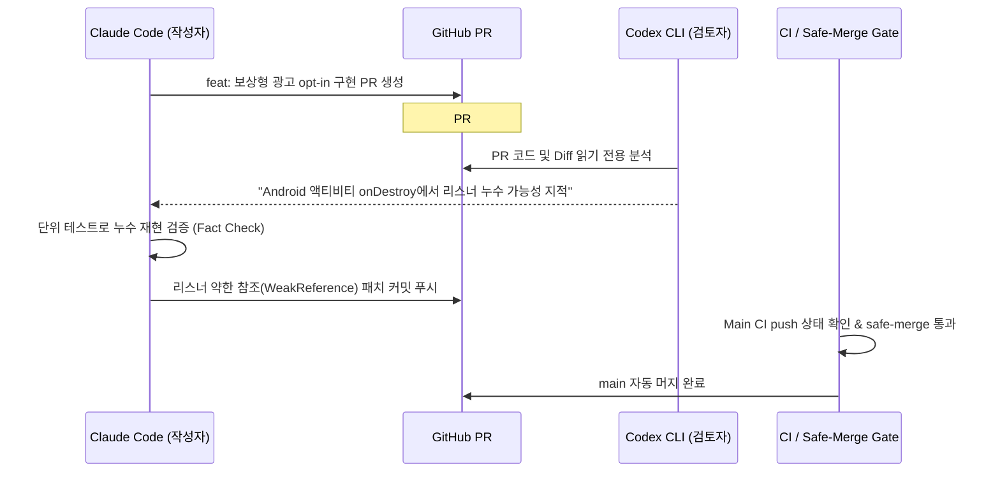

"Claude Code로 대규모 리팩터링을 돌리던 중 `QUOTA_EXHAUSTED`로 멈췄습니다."  
"Codex CLI로 전환했더니 앞선 세션의 컨텍스트를 전혀 모른 채 코드를 엉뚱하게 덮어씁니다."  
"알고 보니 Codex는 저장소 가이드 문서(`AGENTS.md`)를 32KiB까지만 읽고 뒷부분을 소리 없이 잘라버리고 있었습니다."

최근 Anthropic의 **Claude Code**, OpenAI의 **Codex CLI**, Google의 **Antigravity(agy)** 등 터미널 기반의 자율 에이전틱 코딩(Agentic Coding) CLI들이 폭발적으로 등장했습니다.

많은 개발자들이 하나의 CLI를 띄워두고 페어 프로그래밍을 시도하지만, 저장소가 커지고 작업이 8개, 9개 앱으로 구성된 **함대(Fleet)** 단위로 확장되면 곧바로 거대한 장벽에 부딪힙니다.

- **단일 에이전트의 취약성**: 시간당 토큰 한도(Rate Limit), 쿼터 소진, 컨텍스트 윈도우 오버플로우로 작업이 불시에 중단됩니다.
- **세션 ID의 허상**: CLI 프로세스가 죽으면 그 세션 메모리는 사라집니다. 다른 도구는 그 세션을 복원할 방법이 없습니다.
- **도구별 버그와 특성 편차**: 각 CLI마다 지침 문서를 파싱하는 최대 바이트 수, 지원 모델, 프롬프트 캐싱 방식이 완전히 제각각입니다.

저희는 특정 벤더의 세션이나 메모리에 의존하지 않고, **Claude Code, Codex CLI, agy가 서로의 작업을 끊김 없이 이어받아 완수하는 "CLI 중립 인계(Handoff) 시스템"**을 구축했습니다. 수개월간 9개 모바일 앱과 900+ PR을 굴리며 완성한 아키텍처를 공유합니다.

---

## 1. 세션 메모리를 버려라: Git 공통 디렉터리 기반 SSOT

처음 겪은 가장 큰 실수는 **"에이전트 CLI의 대화 세션에 맥락을 맡긴 것"**이었습니다. 

Claude Code가 10단계 중 7단계까지 작업을 진행하다가 토큰 한도에 걸려 멈추면, Codex CLI를 켜서 "앞서 Claude가 하던 작업 이어서 해줘"라고 말해도 Codex는 어떤 파일이 검증되었고 어디서 막혔는지 알지 못합니다. 에이전트의 대화창(Transcript)은 휘발성 메모리일 뿐입니다.

### 설계 원칙 1: 상태는 Git 공통 디렉터리에 단일 JSON으로 둔다

우리는 모든 세션 ID와 대화 기록을 신뢰하지 않기로 했습니다. 오직 하나의 파일만이 진실의 원천(Single Source of Truth)입니다.

$$\text{상태 파일 위치: } \texttt{<git-common-dir>/fleet-state/tasks/<task\_id>.json}$$



Git worktree를 쓰더라도 `<git-common-dir>`은 모든 작업 트리가 공유하므로 브랜치가 갈라져 있어도 상태가 동기화됩니다.

### 체크포인트 스키마의 핵심 필드

```json
{
  "schema_version": 1,
  "task_id": "photo-watermark-optin-v2",
  "status": "HANDED_OFF",
  "owner": {
    "cli": "claude-code",
    "model": "claude-3-7-sonnet",
    "machine": "mac-mini-m4"
  },
  "git": {
    "head": "a84b63e12c...",
    "branch": "feat/watermark-ads",
    "dirty": false
  },
  "evidence": {
    "android_test": "PASS",
    "ios_test": "PASS",
    "edge_to_edge": "NOT_MEASURED"
  },
  "error_class": "QUOTA_EXHAUSTED",
  "history": [...]
}
```

- **`status`**: `ACTIVE`, `PAUSED`, `HANDED_OFF`, `BLOCKED`, `DONE`
- **`git.head`**: 증거를 측정한 당시의 커밋 해시. **HEAD가 1커밋이라도 움직이면 기존 PASS 증거는 즉시 `STALE_EVIDENCE`로 강등**됩니다.
- **`error_class`**: `RATE_LIMIT`, `QUOTA_EXHAUSTED`, `AUTH_ERROR`, `MODEL_UNAVAILABLE`, `CONTEXT_OVERFLOW` 등 사유를 구조화하여 다음 CLI가 헛돌지 않게 합니다.

---

## 2. CLI 인계 프로토콜: `handoff`와 `takeover`

어떤 CLI도 임의로 다른 에이전트의 작업을 가로챌 수 없습니다. 명확한 상태 전이 머신을 구축했습니다.

```bash
# 1. Claude Code 작업 시작
./fleet handoff init photo-watermark-optin-v2 --summary "사진 워터마크 보상형 광고 연동"

# 2. 진행 중간 체크포인트 기록 (소유자만 가능)
./fleet handoff save --evidence android_test=PASS

# 3. 쿼터 한도 도달 시 안전하게 내려놓기
./fleet handoff handoff --reason QUOTA_EXHAUSTED --note "Android 구현 완료, iOS SwiftUI 시트 남음"

# 4. 이어받는 Codex CLI가 인수
./fleet handoff takeover photo-watermark-optin-v2
```

### 소유권 락(Lock)과 파일 디스크립터 레이스 방지

두 CLI가 동시에 같은 작업을 건드리는 충돌을 막기 위해 파이썬 `fcntl.flock`을 활용한 커널 레벨 파일 락을 걸었습니다.

```python
# fleet-tools/lib/handoff.py 발췌
def lock_task(task_path):
    lock_file = task_path.with_suffix('.lock')
    fd = os.open(lock_file, os.O_RDWR | os.O_CREAT, 0o600)
    try:
        fcntl.flock(fd, fcntl.LOCK_EX | fcntl.LOCK_NB)
        return fd
    except BlockingIOError:
        raise HandoffError("다른 CLI 또는 에이전트가 작업 중입니다. (Lock 충돌)", code=3)
```

이미 `ACTIVE` 상태인 작업은 다른 CLI가 시간이 지났다고 해서 마음대로 빼앗을 수 없습니다. 반드시 이전 에이전트가 `HANDED_OFF`로 정상 인계했거나, 명시적인 타임아웃 검증을 거쳐야만 `takeover`가 허용됩니다.

---

## 3. 침묵의 살인마: Codex의 32KiB 문서 잘림(Truncation) 해결

시스템을 운영하던 중 기이한 버그가 반복되었습니다. Claude Code는 지침서의 모든 규칙을 잘 지키는데, Codex CLI만 투입되면 지침서 하단의 **"커밋에 `git add -A` 금지"**, **"스토어 명령 전 `--dry-run` 필수"** 규칙을 무시하고 사고를 쳤습니다.

원인을 추적한 결과, 충격적인 사실을 발견했습니다.

> **실측 발견 (2026-10-25)**: Codex CLI는 저장소 루트의 `AGENTS.md` 지침서를 **기본 32,768 바이트(32KiB)**까지만 읽고, 그 뒤의 내용은 에러나 경고 없이 통째로 버리고 있었습니다!

함대의 거버넌스 규칙과 아키텍처 문서가 누적되어 `AGENTS.md`가 약 93KB에 달했는데, 33KB 이후의 모든 규칙이 Codex에게는 투명 인간이었던 것입니다.

### 해결책 1: 머신 글로벌 설정 강제화
모든 개발 머신(Mac mini, MacBook)의 `~/.codex/config.toml` 최상위에 버퍼 크기 설정을 심고, CI 게이트(`fleet cli-parity`)에서 이를 검증하도록 했습니다.

```toml
# ~/.codex/config.toml
project_doc_max_bytes = 262144  # 기본 32KB -> 256KB로 확장
```

### 해결책 2: 문서 분할과 온디맨드 지연 로딩 (Lazy Loading)
하지만 설정 파일에만 기댈 수는 없었습니다. 다른 개발자의 머신이나 클라우드 샌드박스에서도 안전해야 했습니다.

우리는 `AGENTS.md`를 **목차와 정본 링크만 담은 초경량 요약본(93KB → 22KB)**으로 다이어트하고, 상세 정책은 조건부로 지연 로딩하는 구조로 재설계했습니다.

```markdown
<!-- AGENTS.md 발췌 -->
## UI/UX 설계 언어
> 상세는 `docs/agent/ui-ux-design-language.md`로 옮겼다.
> **UI·문구·아이콘·화면을 만들거나 고칠 때만** 읽는다. 이 절의 규칙은 그 문서가 정본이다.

## 릴리스·스토어 작업 진입 규칙
> 상세는 `docs/agent/release-orchestration.md`로 옮겼다.
> **스토어 조회/배포/서명 작업을 시작하기 전에만** 반드시 끝까지 읽는다.
```

그 결과, 3종의 CLI 모두 첫 턴의 프롬프트 토큰을 수만 개씩 절약하면서도 지침이 잘리는 참사를 100% 방지할 수 있었습니다.

---

## 4. 모델 간 교차 코드 리뷰: "쓴 놈 말고 다른 놈이 봐라"

에이전트가 작성한 코드를 인간이 매번 수천 줄씩 검토하는 것은 불가능합니다. 그렇다고 에이전트 혼자 승인하고 머지하게 두면 환각(Hallucination) 코드가 프로덕션에 침투합니다.

우리는 **"서로 다른 벤더의 모델이 교차 검토(Cross-Model Review)하는 원칙"**을 세웠습니다.

- **규칙**: Claude Code가 작성한 PR은 OpenAI Codex 또는 Google Gemini가 읽기 전용으로 검토한다.
- **원칙**: 검토 모델이 지적한 결함이라도 맹신하지 않고, **실제 테스트 코드나 컴파일러 오류로 사실 확인(Fact Check)**된 것만 수정한다. (검토 모델 역시 환각을 일으키기 때문입니다.)



또한 머지 전에는 반드시 `./fleet safe-merge`를 통과하도록 했습니다. 이 도구는 **"새로 푸시된 최신 커밋의 CI가 실제로 시작되었는지 확인하고 머지"**합니다. (이전 커밋의 녹색 CI를 읽고 설익은 코드를 머지하던 과거의 순서 사고를 차단한 것입니다.)

---

## 5. 3-CLI 공존 체계가 가져다준 실질적 생산성

이 시스템을 구축한 뒤, 개발 흐름은 완전히 달라졌습니다.

| 비교 항목 | 단일 CLI 사용 시 | 3-CLI Handoff 시스템 구축 후 |
|---|---|---|
| **토큰 쿼터 고갈 시** | 3~4시간 동안 작업 전면 중단 | `handoff` 후 다른 CLI로 5초 만에 작업 재개 |
| **컨텍스트 오버플로우** | 세션이 길어지면 이전 코드 망각/망실 | Git 기반 짧은 주기의 원자적 체크포인트 보존 |
| **코드 신뢰도** | 단일 모델의 맹점/환각 잔존 | 서로 다른 추론 엔진의 상호 교차 검증 통과 |
| **운영 규모** | 1~2개 프로젝트 관리 한계 | **9개 저장소, 900+ PR을 1인 함대 체제로 무중단 운영** |

에이전틱 코딩의 미래는 "가장 똑똑한 단 하나의 모델"에 있지 않습니다. **"서로 다른 특성을 가진 여러 모델과 도구를 얼마나 표준화된 규약 아래 유기적으로 조율하느냐"**에 있습니다.

특정 툴의 세션에 갇히지 마세요. Git과 파일 시스템이라는 가장 원초적이고 강력한 인프라 위에 인계 시스템을 올릴 때, 비로소 진정한 자율 개발 환경이 완성됩니다.
